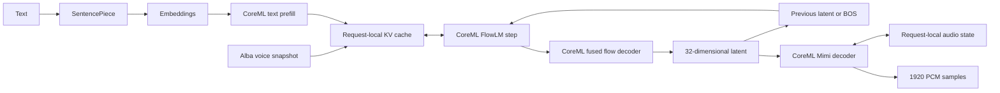

# Pocket TTS

`PocketTTS` is a native CoreML implementation of Kyutai's 100M-parameter
flow-matching speech model. The first bundle supports English and the fixed
Alba preset. It produces mono Float32 PCM at 24 kHz, one 1,920-sample frame
(80 ms) at a time. Arbitrary voice cloning and other language packs are not
part of this bundle.

The compiled graphs and constants come from
[FluidInference's CoreML conversion](https://huggingface.co/FluidInference/pocket-tts-coreml),
revision `91748676fe3c8b2eb3007b3125253bcd898202c3`, `v2.1/english/`.
The export preserves the existing quantization; it does not requantize weights.
Mimi's redundant passthrough outputs are omitted before compilation to avoid
CoreML BNNS input/output name collisions. The runtime retains those unchanged
input tensors between frames. Every graph operation, recurrent input and learned
weight is preserved. A regression test checks this interface transformation.

| Component | Function | Precision |
|---|---|---|
| `cond_prefill.mlmodelc` | Text conditioning, one padded block of up to 256 embeddings | FP16 |
| `flowlm_stepv2.mlmodelc` | Six-layer autoregressive backbone, hidden state and EOS | INT8 linear weights |
| `flow_decoder_fused.mlmodelc` | Eight fused Euler steps, hidden state to 32-dimensional latent | FP16 |
| `mimi_decoder.mlmodelc` | Stateful latent-to-waveform decoding | FP16 |
| `constants_bin/` | English SentencePiece vocabulary, embeddings, BOS, padded Alba state | F32 state |

All four graphs default to `.cpuOnly`; CPU benchmarks permit no GPU or Neural
Engine execution. Callers may explicitly select other compute units for the
first three graphs. Mimi remains on CPU. This module depends on `AudioCommon`
and the lightweight `SpeechRuntime`, and introduces no inference dependency
into existing model modules.

Each text chunk starts with Alba's cached voice state, followed by text
conditioning. The first audio step uses the checkpoint's NaN BOS marker.
Subsequent latents feed back into the language model. Mimi's recurrent state
continues across text chunks. The exporter keeps the K and V halves separate
when padding the voice snapshot to the 512-position cache.

Generation uses request-local deterministic noise, temperature 0.7, EOS logit
threshold −4, and the pinned reference's short-text padding. Text is normalized
and split at sentence/word boundaries around a 50-token target. Chunking avoids
cache overflow and retains every word. A frame/cache limit raises an error
instead of marking truncated speech successful.

The model and Alba voice are CC BY 4.0. Attribute Kyutai, the CoreML conversion
by FluidInference, and Alba MacKenna's voice when redistributing the bundle.
The adapted schema discovery helpers retain their Apache 2.0 notice and license
under `Sources/PocketTTS/`.

See [inference](../inference/pocket-tts.md) and
[CPU measurements](../benchmarks/pocket-tts.md).
